<p align="center">
  <picture>
    <source media="(prefers-color-scheme: dark)" srcset="public/peel-logo-horizontal-dark-1600.png">
    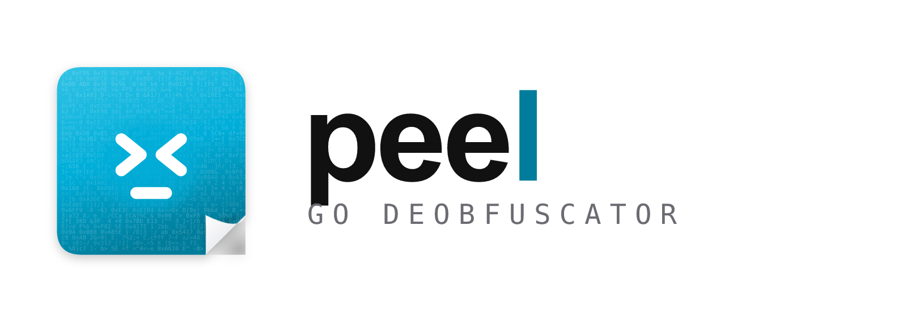
  </picture>
</p>

<p align="center">
  <b>Peel the obfuscation off Go binaries, right in your browser.</b><br>
  Open source · MIT · free forever · your binary never leaves your device
</p>

<p align="center">
  <a href="README.tr.md">Türkçe</a> ·
  <a href="#quick-start">Quick start</a> ·
  <a href="#what-it-recovers">What it recovers</a> ·
  <a href="#analysis-report">Report</a> ·
  <a href="#command-line">CLI</a> ·
  <a href="#library">Library</a> ·
  <a href="#how-it-works">How it works</a> ·
  <a href="#honest-limits">Limits</a>
</p>

<p align="center">
  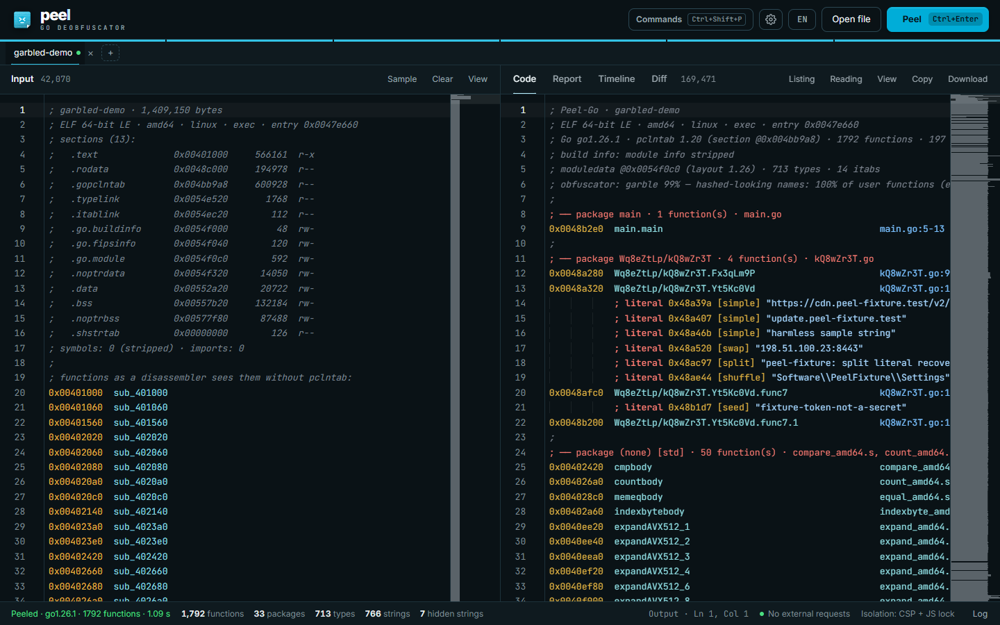
</p>

---

## What is PEEL?

PEEL is a deobfuscator and analyser for compiled Go programs. Open an ELF, PE or Mach-O file (amd64, arm64 or 386;
stripped, garbled or not), press **Peel** (`Ctrl + Enter`), and you get back what the Go runtime itself needs to keep:
every function name with its address, source file and line range, the Go version, the main module and its dependencies,
the build settings and the type names. Strings that garble's `-literals` mode hid behind little decoder functions are
recovered by emulating those decoders.

- **It never runs the binary.** Everything is parsed from bytes. The hidden-string decoders are interpreted by a small,
  bounded x86-64 emulator written in JavaScript: no system calls, no native code, memory is the file's own sections plus a
  scratch stack and heap.
- **It does not guess.** A string is reported only when every one of its bytes was computed. Anything the emulator could
  not finish is listed as "not recovered" with its address and reason.
- **It tells you what the binary is.** Toolchain and Go version, obfuscators (garble, gobfuscate) with confidence and
  evidence, UPX packing, stripped symbols, capabilities from linked functions (network, process execution, files),
  notable packages, crypto constants, IOCs (URLs, domains, IPs, Discord webhooks, Telegram bots) and a threat score.
- **It exports to your disassembler.** Ghidra (Python), IDA (IDAPython) and radare2/rizin scripts rename every function and
  comment every decoded string; JSON carries everything.
- **It stays on your machine.** No server, no upload, no telemetry. The status bar counts every external request the page makes.

## Scope

| Input | How it is handled |
|---|---|
| ELF (32/64-bit, little and big endian) | sections, program headers (also without a section table), `.symtab`, `.dynsym`, `DT_NEEDED` |
| PE / PE32+ | sections, COFF symbol table (present without `-s`), import table |
| Mach-O 64, universal (fat) | segments, sections, `LC_SYMTAB`, dylibs; the amd64 slice of a fat file is chosen first |
| pclntab | Go 1.2–1.15, 1.16–1.17, 1.18–1.19 and 1.20+ layouts; found by section name, by symbol, or by scanning for the magic value in stripped files |
| `runtime.buildinfo` | inline strings (Go 1.18+) and the older pointer format; without build info the version comes from the `go1.x` runtime string |
| `moduledata` | located through its pointer to pclntab and validated per layout (1.7–1.15, 1.16, 1.18, 1.20, 1.26); typelinks and itablinks |

Architectures: names, files, lines, build info, types and string references work on amd64, arm64 and 386. Hidden-string
emulation is amd64 only.

## Quick start

You need Node.js 25 or newer.

```bash
git clone https://github.com/LLCForge/Peel-Go.git
cd Peel-Go
npm install
npm run dev
```

Open <http://localhost:5173>, drop a Go binary onto the page or click **Try the sample binary**, then press **Peel**.

```bash
npm run build
```

`dist/` is the whole app as static files, including a `_headers` file with the sandbox CSP for Netlify and Cloudflare Pages.
After the first visit it also works offline as a PWA.

## Example

The garble-style fixture from the test suite (stripped, hashed package and function names, module info removed, seven
hidden strings, one per garble obfuscator family):

```text
$ npx peel-go garbled-demo --lang en
; Peel-Go · garbled-demo
; ELF 64-bit LE · amd64 · linux · exec · entry 0x0047e660
; Go go1.26.1 · pclntab 1.20 (section @0x004bb9a8) · 1792 functions · 197 files
; build info: module info stripped
; moduledata @0x0054f0c0 (layout 1.26) · 713 types · 14 itabs
...
0x0048a320  Wq8eZtLp/kQ8wZr3T.Yt5Kc0Vd                       kQ8wZr3T.go:11-120       3232 B
            ; literal 0x48a39a [simple] "https://cdn.peel-fixture.test/v2/config.json"
            ; literal 0x48a520 [swap] "198.51.100.23:8443"
            ; literal 0x48ac97 [split] "peel-fixture: split literal recovered"
            ; literal 0x48ae44 [shuffle] "Software\\PeelFixture\\Settings"
0x0048afc0  Wq8eZtLp/kQ8wZr3T.Yt5Kc0Vd.func7                 kQ8wZr3T.go:108-119      576 B
            ; literal 0x48b1d7 [seed] "fixture-token-not-a-secret"
[none 0/100] Input: ELF amd64 Go binary built with go1.26.1; 1792 function(s) recovered from pclntab 1.20,
5 outside the standard library, in 33 package(s). Obfuscator: garble (99%). Techniques: Stripped symbols.
7 hidden string(s) were recovered by emulating their decoders. ...
```

All strings and addresses in the fixtures are harmless: `.test` domains and RFC 5737 documentation IPs.

## Screenshots

<table>
  <tr>
    <td width="50%">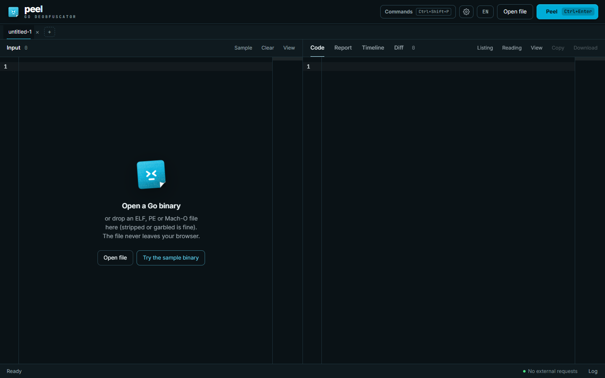<br><sub><b>Start screen.</b> Open a file or a folder, drop one, or try the sample.</sub></td>
    <td width="50%"><br><sub><b>Listing.</b> Left: what a disassembler sees. Right: names, source lines, decoded strings.</sub></td>
  </tr>
  <tr>
    <td>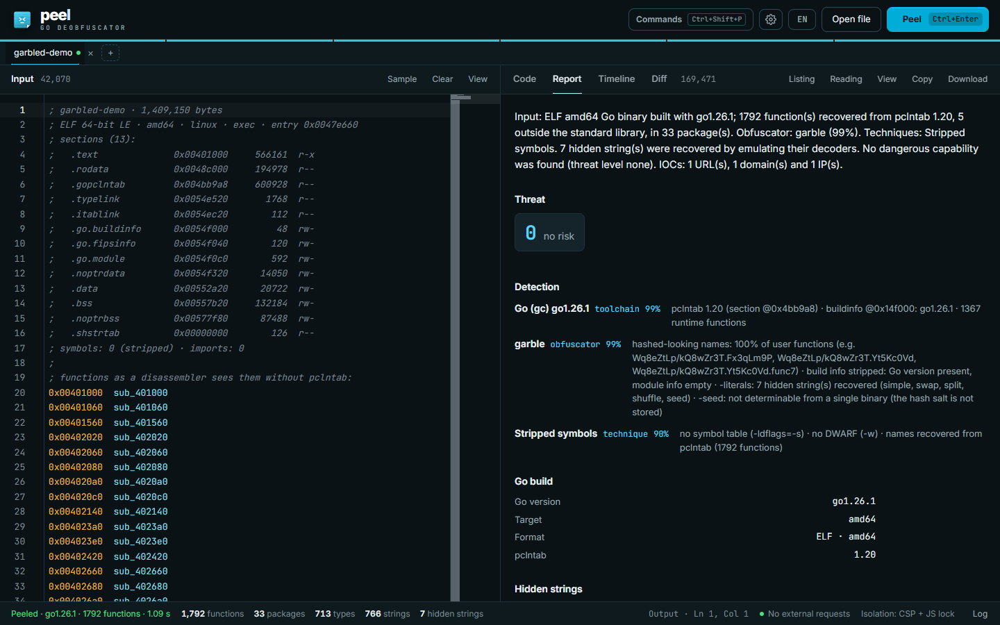<br><sub><b>Report.</b> Summary, threat, detections with evidence, Go build.</sub></td>
    <td>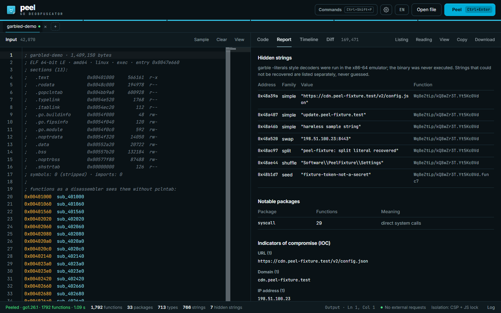<br><sub><b>Hidden strings.</b> Address, garble family, value and function; IOCs below.</sub></td>
  </tr>
  <tr>
    <td>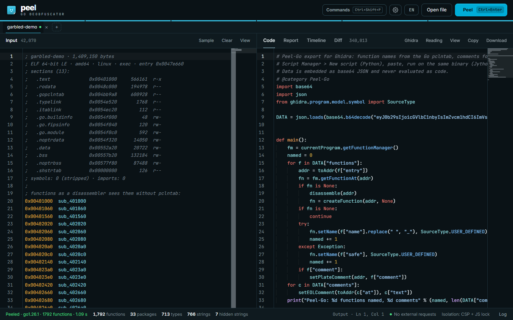<br><sub><b>Exports.</b> Ghidra, IDA and r2 scripts and JSON, one click away.</sub></td>
    <td>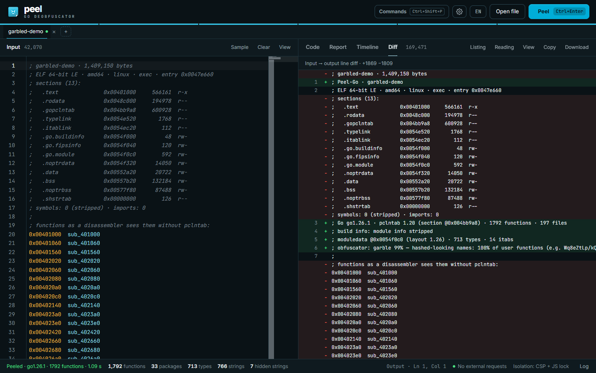<br><sub><b>Diff.</b> The raw view against the peeled listing.</sub></td>
  </tr>
  <tr>
    <td>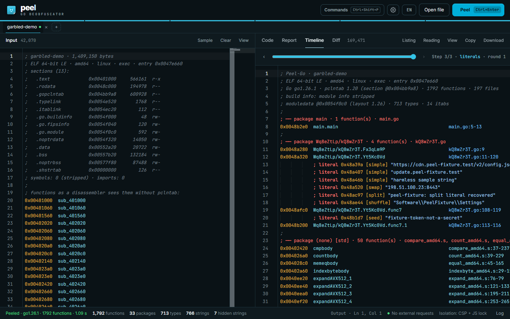<br><sub><b>Timeline.</b> The listing after pclntab, strings and hidden strings.</sub></td>
    <td>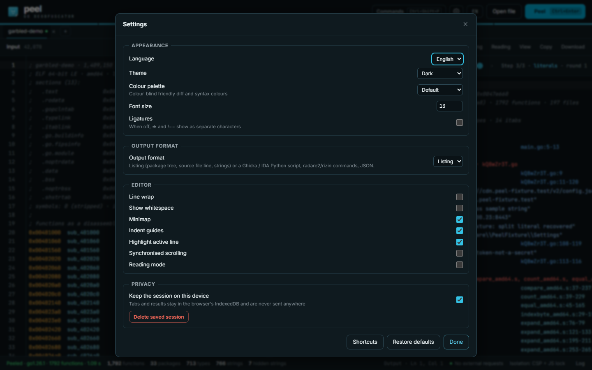<br><sub><b>Settings.</b> Language, theme, colour-blind palettes, output format, editor and session options.</sub></td>
  </tr>
</table>

<p align="center">
  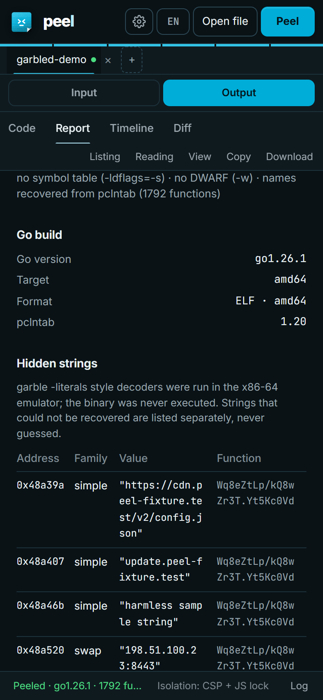<br>
  <sub>The interface also works on a phone.</sub>
</p>

## What it recovers

| Pass | What | How |
|---|---|---|
| `container` | format, architecture, sections, symbols, imports, UPX markers | own ELF / PE / Mach-O parsers, bounds-checked |
| `buildinfo` | Go version, main module, dependencies with sums and `=>` replacements, `-ldflags` and other build settings, VCS revision | `\xff Go buildinf:` header, inline or pointer format |
| `pclntab` | every function: entry, end, name, package, source file, line range; all source files | functab + `_func` records, pcfile/pcln tables, cutab/filetab; the 1.18+ text base is checked against moduledata |
| `moduledata` | type names and interface implementations (`*main.Config → main.Checker`) | moduledata found by its pclntab pointer, typelinks / itablinks, `runtime._type` names (both name encodings) |
| `strings` | the Go string constants each function references, with addresses | Go strings are not NUL-terminated; their bounds are read from the code: `LEA` + length in the next ABI register or the next struct word (amd64, 386), `ADRP`+`ADD` + `MOVZ`/`ORR` (arm64) |
| `literals` | strings hidden by garble `-literals` and gobfuscate (amd64) | emulation of every user function that calls `runtime.slicebytetostring`; see below |

### Hidden strings (garble `-literals`)

garble replaces each string literal with an inline function that rebuilds it at run time. PEEL emulates every non-standard
function that calls `runtime.slicebytetostring`, from its entry, with unknown arguments. The decoder works only on constants,
so the bytes come out fully known; when the conversion is reached, the string is recorded with the call site. The runtime
helpers the decoders use are modelled (`growslice`, `makeslice`, `newobject`, `mallocgc*`, `stringtoslicebyte`, `memmove`,
`memclrNoHeapPointers`; `duffzero`/`duffcopy` are executed), closures are followed (the `seed` family calls one per byte),
unknown branches fork (bounded), and the structure of the decoding run gives the family:

| Family | Shape |
|---|---|
| `simple` | key and data arrays, a loop that `xor`s, adds or subtracts (gobfuscate's mask `xor` lands here too) |
| `swap` | a loop that swaps byte pairs at positions read from an index array, `xor`ed with a running key |
| `split` | a `switch`-based state machine appending chunks, then a final `xor` with an evolving key |
| `shuffle` | no loop: each byte is the `xor` of two shuffled array elements (and an external global key) |
| `seed` | a self-returning closure called once per byte, `fnc(x)(y)(z)…` |
| `plain` | no obfuscation shape, just `string([]byte{…})` from constants |

### Detection

- **garble**: hashed-looking package and function names (scored per identifier; 0.4 % false positives over the standard
  library), build info with a Go version but no module info, `-literals` strings, `-tiny` (no file or line information on
  user functions). `-seed` cannot be told from a single binary and the report says so.
- **gobfuscate**: random lowercase package paths together with mask-`xor` strings.
- **UPX**: `UPX!` headers, `UPX0`/`UPX1` sections, the `$Info`/`$Id` strings, ELF without a section table; reported, not unpacked.
- **Stripped symbols**: no symbol table (`-ldflags=-s`), no DWARF (`-w`); names still come back from pclntab.

## Analysis report

- **Summary** in Turkish or English, built only from findings.
- **Detection** with confidence and evidence: toolchain, obfuscator, packer, techniques.
- **Go build**: version, module, target, cgo, VCS, dependency table.
- **Hidden strings**: address, family, value, function; and every string that could not be recovered, with its reason.
- **Capabilities**: functions linked into the binary in the network, process execution, file and other groups. The Go linker
  drops unused code, so a linked `os/exec.(*Cmd).Start` means the program can start processes. Nothing was executed.
- **Notable packages** (`os/exec`, `net/http`, `syscall`, `golang.org/x/sys/windows`, `plugin`, crypto…) and **crypto constants**
  (AES, SHA-256/512, MD5, SHA-1, ChaCha20, CRC-32, Blowfish, RC2).
- **IOCs** from string constants and recovered strings: URLs, domains, IPs, e-mails, Discord webhooks, Telegram bots.
- **Threat score** (0 to 100) with classes: network, command execution, injection, persistence, anti-analysis, credential
  access, exfiltration, dynamic code, packed.
- **Metrics** and per-pass timings. **Cross-check**: every function entry lies in code and inside moduledata's text range.

## Command line

```bash
npx peel-go app                          # listing to stdout, summary to stderr
npx peel-go app.exe -o app.ghidra.py --ida app.ida.py --r2 app.r2 -r report.json
npx peel-go app -f json -q > app.json
npx peel-go samples/ -d out/ -f r2 --json --fail-on high
cat app | npx peel-go - -r text --lang en
```

| Option | |
|---|---|
| `-o, --out <file>` | write the output; the format comes from the extension (`.txt` listing, `.py` Ghidra or `-f ida`, `.r2`, `.json`) |
| `-f, --format listing\|ghidra\|ida\|r2\|json` | format for stdout and `-d` |
| `--listing`, `--ghidra`, `--ida`, `--r2 <file>` | also write that format |
| `-d, --out-dir <dir>` | write `<name><ext>` files; a directory input keeps its structure (only ELF/PE/Mach-O files are taken) |
| `-r, --report json\|text\|<file>` | report to stdout or to a file (`.txt` gives text, anything else JSON) |
| `--only <pass,…>` | run only these optional passes (`buildinfo, moduledata, strings, literals`) |
| `--lang tr\|en` | report language |
| `--fail-on low\|medium\|high\|critical` | exit code 4 when the threat level reaches the threshold |
| `--timeout <sec>` | hard time limit per file (default 90) |

Exit codes: 0 ok, 1 error, 2 usage error, 4 `--fail-on` threshold reached.

## Library

```js
import { peel, exportAs, reportText } from 'peel-go';

const r = await peel(bytes, { lang: 'en' });   // bytes: Uint8Array of an ELF, PE or Mach-O file
r.functions      // [{ entry, end, size, name, pkg, std, file, startLine, endLine }]
r.buildinfo      // { path, main, deps, settings }
r.literals       // { recovered: [{ site, func, value, family }], unresolved: [...] }
r.report         // detection, protection, threat, behaviour, iocs, literals, crypto, notable, go, metrics, summary
r.listing        // the peeled listing; r.rawView is the "before" view
exportAs(r, 'ghidra')  // 'listing' | 'ghidra' | 'ida' | 'r2' | 'json'
```

`peel` runs in the calling thread with bounded budgets. Pass `{ sandbox }` (from `src/sandbox/node-host.js` or
`web-host.js`) to run it in a worker with a hard deadline, as the CLI and the web app do.

## How it works

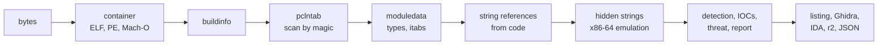

Pure JavaScript, no native code, no runtime dependency besides the editor (CodeMirror) and the fonts.

| Folder | Contents |
|---|---|
| `src/core/` | ELF/PE/Mach-O readers, pclntab, buildinfo, moduledata, string references, x86-64 decoder and emulator, literal recovery, synthetic binary builder |
| `src/passes/` | the 6 passes |
| `src/report/` | detection, threat, IOCs, crypto constants, summary, listing, export scripts |
| `src/sandbox/` | worker hosts (browser Web Worker, Node `worker_threads`) and the watchdog |
| `src/ui/` | the web interface |
| `src/cli/`, `bin/` | the CLI |
| `test/` | fixtures and unit tests |
| `scripts/` | fixture builder, benchmark |

## Safety model

- **The binary is never executed.** Not in the browser, not in Node. The emulator interprets a subset of x86-64 in
  JavaScript: there are no system calls, indirect calls into the standard library are skipped, unsupported instructions end
  the path. Budgets: 400,000 instructions and 48 paths per function, 6 million instructions and 12 s per file, call depth 3.
- **Browser.** The work runs in a Web Worker with its own CSP response header
  (`default-src 'none'; script-src 'self'; connect-src 'self'`) that, before it handles anything, removes `fetch`,
  `XMLHttpRequest`, `WebSocket`, `EventSource`, `WebTransport`, `importScripts`, nested workers, `caches`, `indexedDB`,
  `BroadcastChannel`, `eval`, the `Function` constructors and string timers. A watchdog kills a worker that misses its
  deadline; **Stop** kills it at once. Hosts that cannot set headers (GitHub Pages) get only the JavaScript lock, and the page warns about it.
- **Node.** The CLI runs each file in a `worker_threads` thread with a memory cap and a hard deadline (`--timeout`).
- **Every read is bounds-checked;** corrupted or hostile files produce a parse error, not a crash (the test suite mutates
  binaries at random to check this).
- **Exports are injection-safe.** Function names come from the binary. Python scripts carry the data as base64 JSON, never
  as code; r2 names are reduced to `[A-Za-z0-9_.$]` and comments are written with `CCu base64:`.
- **Report text is inert.** Everything from the binary is printed with `textContent`.

## Honest limits

- **Hidden strings: amd64 only.** On arm64 and 386 the obfuscated strings stay hidden (names, files, types and plain strings
  still work).
- **The emulator is a subset.** It covers what the Go compiler emits in decoders: moves, arithmetic, shifts and rotates,
  `imul`/`mul`/`div`, conditional moves and sets, SSE moves, `rep movs/stos`, calls and returns. Atomics, AVX, x87 and system
  instructions end the path; such strings are listed as not recovered. Decoders that depend on run-time input (environment,
  files, network) cannot be recovered statically, by design.
- **Families are inferred from structure.** The string value is exact; the family label is a heuristic, and a
  future garble version with new templates may be labelled `simple` or `plain` even when decoded correctly.
- **Fixtures are not built with garble itself.** garble was not installed on the machine that built them, and the fixture
  script never installs tools. The garble fixtures are compiled with the real Go toolchain from source that reproduces garble's
  five literal templates, hashed naming and `-X runtime.modinfo=`. If garble is on `PATH`, `npm run fixtures` also builds a
  real garble binary.
- **garble name hashing is detected, not reversed.** The original names are not stored in the binary.
- **UPX is detected, not unpacked.** Unpack with `upx -d` and load the result.
- **Old Go.** pclntab 1.2–1.17 and the pointer build-info format are tested with synthetic binaries only; moduledata layouts
  before 1.20 are implemented from the runtime sources but not tested against real binaries.
- **Big-endian targets** (ppc64, s390x, mips) parse, but string references and emulation are not implemented for them.
- **gccgo and TinyGo** binaries have no gc pclntab; they are reported as non-Go or with partial results.
- **String references** are recovered from common code patterns; strings built indirectly (tables of strings, `embed` files)
  are found only by the printable-run fallback, when a binary has almost no code references.

## Tests

```bash
npm test                 # 11 real Go binaries through the whole pipeline, then 12 unit test files
node test/run.js garble  # fixtures whose name contains "garble", with log, listing and summary
npm run fixtures         # rebuild test/fixtures with Go (garble too, if installed)
npm run bench            # timings per fixture
```

The fixtures ([`scripts/make-fixtures.js`](scripts/make-fixtures.js)) are three harmless programs built with Go 1.26.1,
`-trimpath`, `-buildvcs=false` and `-buildid=`: a small "update checker" with `os/exec` and a replaced local dependency for
linux/amd64 (with and without symbols), linux/arm64, linux/386, windows/amd64, windows/386, darwin/amd64 and darwin/arm64;
the garble-style program for linux and windows amd64; the gobfuscate-style program for linux amd64. Together 7.1 MB gzip.

Measured on this repository (Node 25.8.1, Windows, x86-64):

- `npm test`: 11/11 fixtures, 12/12 unit test files.
- pclntab: 48 synthetic cases (4 layouts × ELF64/ELF32/ELF64-BE/PE32+/PE32/Mach-O × found by section or by scan) plus
  3 real binaries; 300 random corruptions of the table and 120 of whole binaries without an exception.
- Hidden strings: 7 of 7 garble-style strings (all five families) on ELF and PE, 2 of 2 gobfuscate-style strings,
  in 3,564 emulated instructions and 7 to 18 ms.
- Name scoring: 0.42 % of standard-library function names look hashed (garble needs at least half of the user functions).
- Export scripts: the Ghidra and IDA scripts are executed by Python against stubbed APIs and rename all 1,792 functions.
- Speed: 1.3 to 1.6 MB binaries peel in 0.16 to 0.41 s each in the same process (median of 5 runs).
- A privacy test scans every fixture and text file for user directories, temp paths and this machine's names.

## Contributing

Issues and pull requests are welcome. If you have a Go binary PEEL does not handle, please open an issue with a small,
harmless program that reproduces it; a pull request with a fixture proving the fix is the fastest way in.

## License

[MIT](LICENSE). No paid tier, no account, no telemetry.
