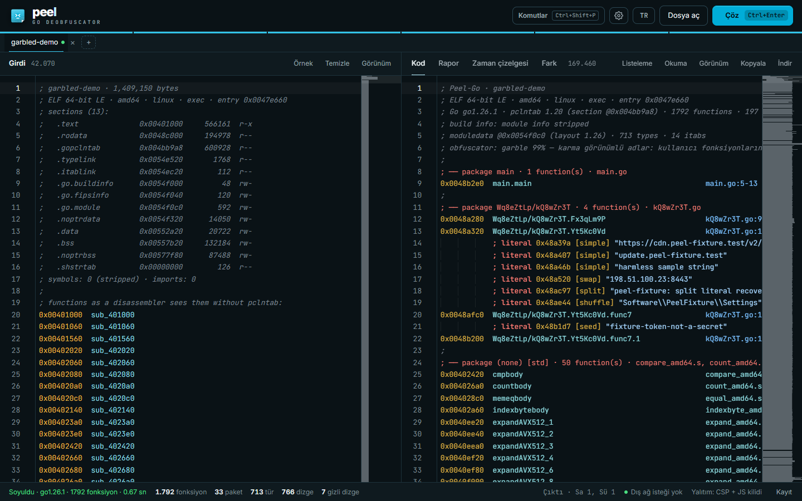
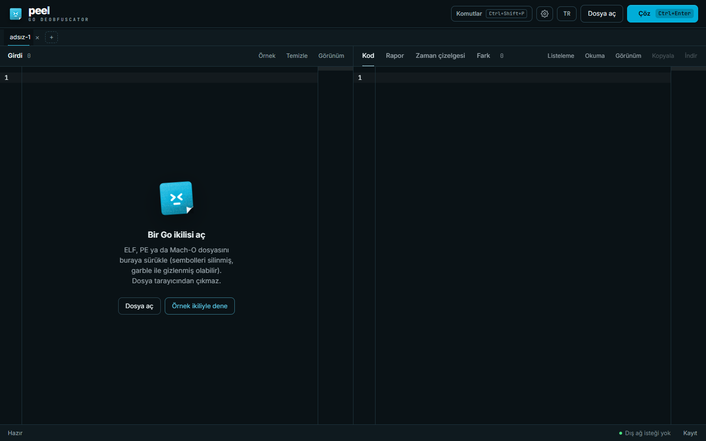
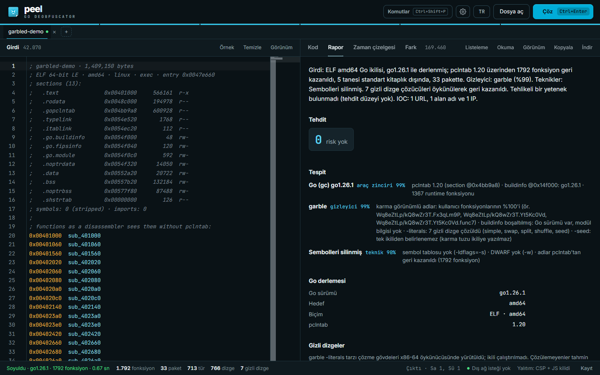
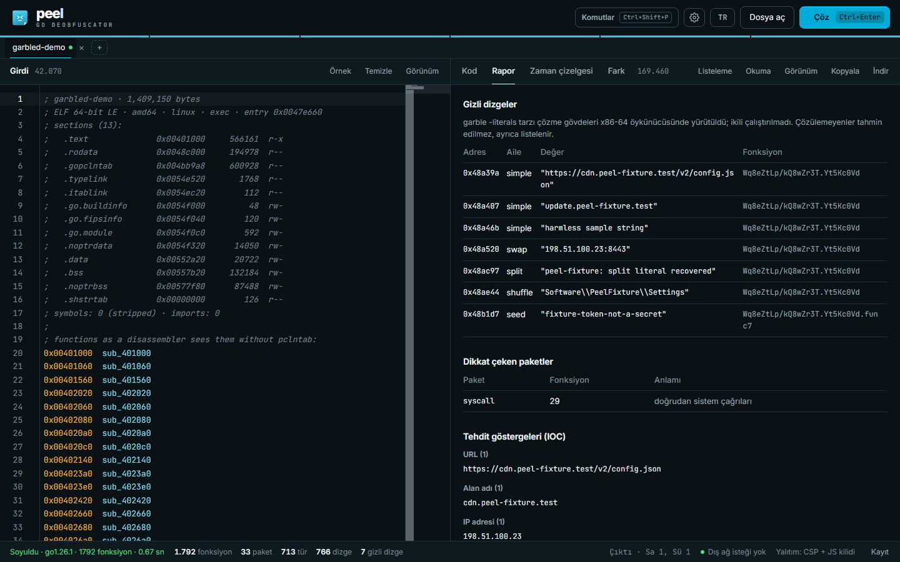
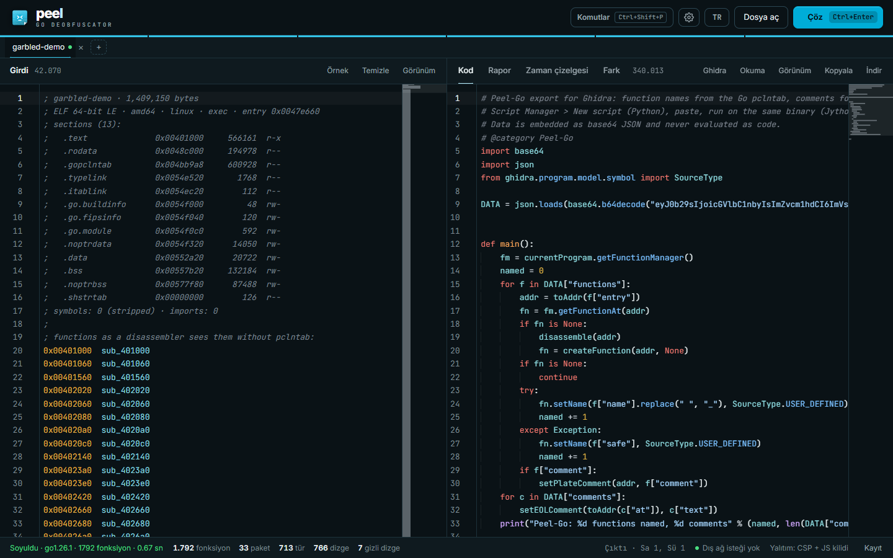
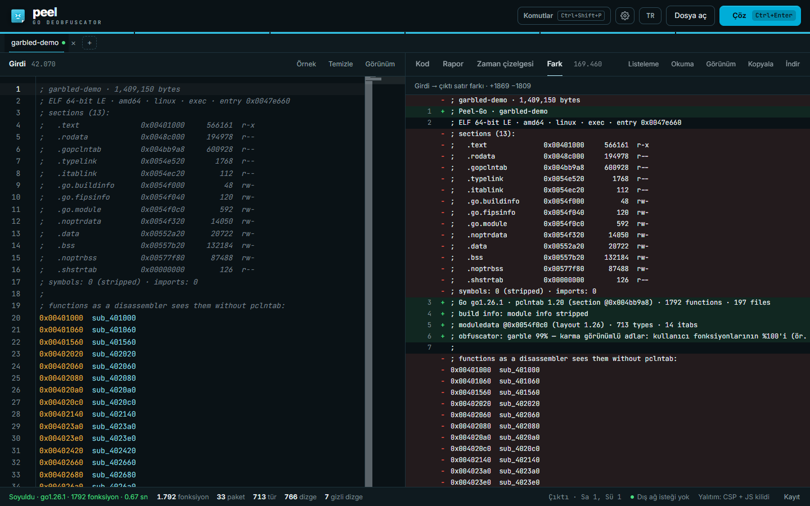
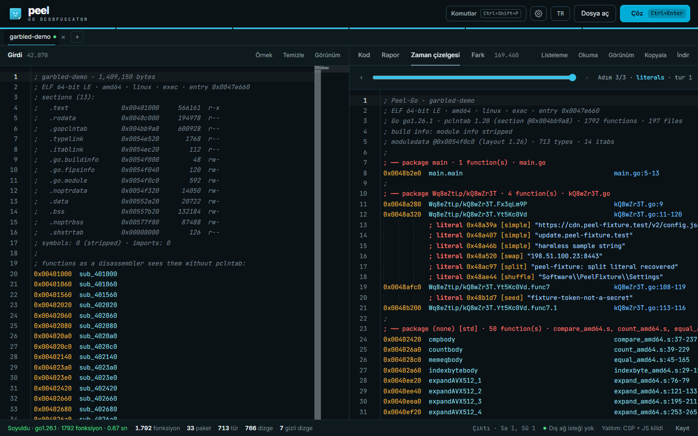
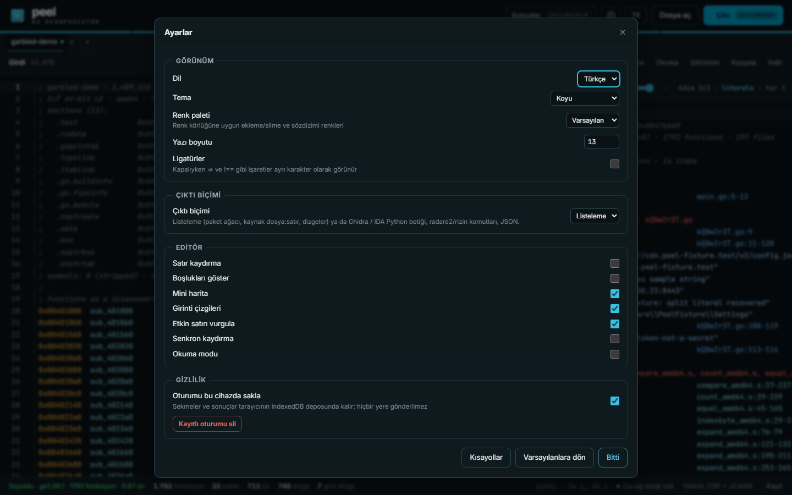
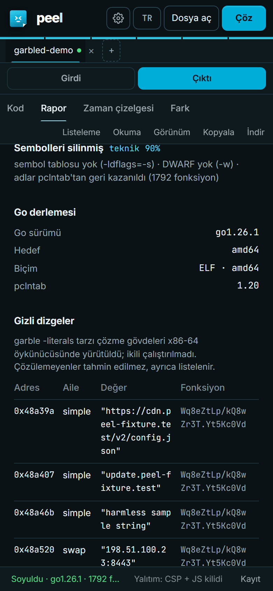
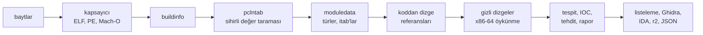

<p align="center">
  <picture>
    <source media="(prefers-color-scheme: dark)" srcset="public/peel-logo-horizontal-dark-1600.png">
    
  </picture>
</p>

<p align="center">
  <b>Go ikililerindeki gizlemeyi tarayıcında soy.</b><br>
  Açık kaynak · MIT · sonsuza dek ücretsiz · ikilin cihazından çıkmaz
</p>

<p align="center">
  <a href="README.md">English</a> ·
  <a href="#hızlı-başlangıç">Hızlı başlangıç</a> ·
  <a href="#neleri-geri-kazanır">Neleri geri kazanır</a> ·
  <a href="#analiz-raporu">Rapor</a> ·
  <a href="#komut-satırı">CLI</a> ·
  <a href="#kitaplık">Kitaplık</a> ·
  <a href="#nasıl-çalışır">Nasıl çalışır</a> ·
  <a href="#dürüst-sınırlar">Sınırlar</a>
</p>

<p align="center">
  
</p>

---

## PEEL nedir?

PEEL, derlenmiş Go programları için bir deobfuscator ve analiz aracıdır. Bir ELF, PE ya da Mach-O dosyası aç (amd64,
arm64 ya da 386; sembolleri silinmiş, garble ile gizlenmiş ya da değil), **Çöz**'e bas (`Ctrl + Enter`); Go çalışma
zamanının kendisi için saklamak zorunda olduğu her şey geri gelir: adresiyle, kaynak dosyasıyla ve satır aralığıyla her
fonksiyon adı, Go sürümü, ana modül ve bağımlılıkları, derleme ayarları ve tür adları. garble'ın `-literals` kipinin küçük
çözücü fonksiyonların arkasına sakladığı dizgeler, bu çözücüler öykünülerek geri kazanılır.

- **İkiliyi asla çalıştırmaz.** Her şey baytlardan ayrıştırılır. Gizli dizge çözücüleri JavaScript ile yazılmış küçük,
  sınırlı bir x86-64 öykünücüsünde yorumlanır: sistem çağrısı yok, yerel kod yok; bellek, dosyanın kendi bölümleri ile
  bir çalışma yığını ve öbeğidir.
- **Tahmin etmez.** Bir dizge ancak her baytı hesaplanabildiyse raporlanır. Öykünücünün bitiremediği her şey adresi ve
  nedeniyle "çözülemedi" olarak listelenir.
- **İkilinin ne olduğunu söyler.** Araç zinciri ve Go sürümü, güven ve kanıtla gizleyiciler (garble, gobfuscate), UPX
  paketlemesi, silinmiş semboller, bağlanmış fonksiyonlardan yetenekler (ağ, süreç çalıştırma, dosya), dikkat çeken
  paketler, kripto sabitleri, IOC'ler (URL, alan adı, IP, Discord webhook, Telegram bot) ve tehdit puanı.
- **Disassembler'ına aktarır.** Ghidra (Python), IDA (IDAPython) ve radare2/rizin betikleri her fonksiyonu adlandırır,
  çözülen her dizgeyi yorum olarak ekler; JSON her şeyi taşır.
- **Makinende kalır.** Sunucu yok, yükleme yok, telemetri yok. Durum çubuğu sayfanın yaptığı her dış isteği sayar.

## Kapsam

| Girdi | Nasıl işlenir |
|---|---|
| ELF (32/64 bit, küçük ve büyük sonlu) | bölümler, program başlıkları (bölüm tablosu olmadan da), `.symtab`, `.dynsym`, `DT_NEEDED` |
| PE / PE32+ | bölümler, COFF sembol tablosu (`-s` yoksa bulunur), içe aktarma tablosu |
| Mach-O 64, evrensel (fat) | segmentler, bölümler, `LC_SYMTAB`, dylib'ler; fat dosyada önce amd64 dilimi seçilir |
| pclntab | Go 1.2–1.15, 1.16–1.17, 1.18–1.19 ve 1.20+ düzenleri; bölüm adıyla, sembolle ya da silinmiş dosyalarda sihirli değer taranarak bulunur |
| `runtime.buildinfo` | satır içi dizgeler (Go 1.18+) ve eski işaretçili biçim; build bilgisi yoksa sürüm çalışma zamanındaki `go1.x` dizgesinden gelir |
| `moduledata` | pclntab'ı gösteren işaretçisinden bulunur, düzene göre doğrulanır (1.7–1.15, 1.16, 1.18, 1.20, 1.26); typelinks ve itablinks |

Mimariler: adlar, dosyalar, satırlar, build bilgisi, türler ve dizge referansları amd64, arm64 ve 386'da çalışır. Gizli
dizge öykünmesi yalnızca amd64'tedir.

## Hızlı başlangıç

Node.js 25 ya da daha yenisi gerekir.

```bash
git clone https://github.com/LLCForge/Peel-Go.git
cd Peel-Go
npm install
npm run dev
```

<http://localhost:5173> adresini aç, bir Go ikilisini sayfaya sürükle ya da **Örnek ikiliyle dene**'ye tıkla, sonra **Çöz**'e bas.

```bash
npm run build
```

`dist/` uygulamanın tamamıdır (statik dosyalar), Netlify ve Cloudflare Pages için sandbox CSP'sini taşıyan bir `_headers`
dosyası dahil. İlk ziyaretten sonra PWA olarak çevrimdışı da çalışır.

## Örnek

Test takımındaki garble tarzı fixture (sembolleri silinmiş, karma paket ve fonksiyon adları, modül bilgisi kaldırılmış,
her garble obfuscator ailesinden bir tane olmak üzere yedi gizli dizge):

```text
$ npx peel-go garbled-demo --lang en
; Peel-Go · garbled-demo
; ELF 64-bit LE · amd64 · linux · exec · entry 0x0047e660
; Go go1.26.1 · pclntab 1.20 (section @0x004bb9a8) · 1792 functions · 197 files
; build info: module info stripped
; moduledata @0x0054f0c0 (layout 1.26) · 713 types · 14 itabs
...
0x0048a320  Wq8eZtLp/kQ8wZr3T.Yt5Kc0Vd                       kQ8wZr3T.go:11-120       3232 B
            ; literal 0x48a39a [simple] "https://cdn.peel-fixture.test/v2/config.json"
            ; literal 0x48a520 [swap] "198.51.100.23:8443"
            ; literal 0x48ac97 [split] "peel-fixture: split literal recovered"
            ; literal 0x48ae44 [shuffle] "Software\\PeelFixture\\Settings"
0x0048afc0  Wq8eZtLp/kQ8wZr3T.Yt5Kc0Vd.func7                 kQ8wZr3T.go:108-119      576 B
            ; literal 0x48b1d7 [seed] "fixture-token-not-a-secret"
[none 0/100] Input: ELF amd64 Go binary built with go1.26.1; 1792 function(s) recovered from pclntab 1.20,
5 outside the standard library, in 33 package(s). Obfuscator: garble (99%). Techniques: Stripped symbols.
7 hidden string(s) were recovered by emulating their decoders. ...
```

Fixture'lardaki tüm dizgeler ve adresler zararsızdır: `.test` alan adları ve RFC 5737 belge IP'leri.

## Ekran görüntüleri

<table>
  <tr>
    <td width="50%"><br><sub><b>Başlangıç.</b> Bir dosya ya da klasör aç, sürükle ya da örneği dene.</sub></td>
    <td width="50%"><br><sub><b>Listeleme.</b> Solda disassembler'ın gördüğü, sağda adlar, kaynak satırları, çözülen dizgeler.</sub></td>
  </tr>
  <tr>
    <td><br><sub><b>Rapor.</b> Özet, tehdit, kanıtlı tespitler, Go derlemesi.</sub></td>
    <td><br><sub><b>Gizli dizgeler.</b> Adres, garble ailesi, değer ve fonksiyon; altında IOC'ler.</sub></td>
  </tr>
  <tr>
    <td><br><sub><b>Dışa aktarma.</b> Ghidra, IDA ve r2 betikleri ile JSON, tek tıkla.</sub></td>
    <td><br><sub><b>Fark.</b> Ham görünüm ile soyulmuş listeleme.</sub></td>
  </tr>
  <tr>
    <td><br><sub><b>Zaman çizelgesi.</b> pclntab, dizgeler ve gizli dizgelerden sonraki listeleme.</sub></td>
    <td><br><sub><b>Ayarlar.</b> Dil, tema, renk körlüğü paletleri, çıktı biçimi, editör ve oturum seçenekleri.</sub></td>
  </tr>
</table>

<p align="center">
  <br>
  <sub>Arayüz telefonda da çalışır.</sub>
</p>

## Neleri geri kazanır

| Geçiş | Ne | Nasıl |
|---|---|---|
| `container` | biçim, mimari, bölümler, semboller, içe aktarmalar, UPX işaretleri | kendi ELF / PE / Mach-O ayrıştırıcıları, sınır denetimli |
| `buildinfo` | Go sürümü, ana modül, toplamları ve `=>` yer değiştirmeleriyle bağımlılıklar, `-ldflags` ve diğer derleme ayarları, VCS revizyonu | `\xff Go buildinf:` başlığı, satır içi ya da işaretçili biçim |
| `pclntab` | her fonksiyon: giriş, bitiş, ad, paket, kaynak dosya, satır aralığı; tüm kaynak dosyalar | functab + `_func` kayıtları, pcfile/pcln tabloları, cutab/filetab; 1.18+ metin tabanı moduledata ile denetlenir |
| `moduledata` | tür adları ve arayüz uygulamaları (`*main.Config → main.Checker`) | pclntab işaretçisinden bulunan moduledata, typelinks / itablinks, `runtime._type` adları (iki ad kodlaması da) |
| `strings` | her fonksiyonun başvurduğu Go dizge sabitleri, adresleriyle | Go dizgeleri NUL ile bitmez; sınırları koddan okunur: `LEA` + bir sonraki ABI yazmacındaki ya da yapının bir sonraki sözcüğündeki uzunluk (amd64, 386), `ADRP`+`ADD` + `MOVZ`/`ORR` (arm64) |
| `literals` | garble `-literals` ve gobfuscate ile gizlenen dizgeler (amd64) | `runtime.slicebytetostring` çağıran her kullanıcı fonksiyonunun öykünmesi; aşağıya bakın |

### Gizli dizgeler (garble `-literals`)

garble her dizge sabitini, onu çalışma anında yeniden kuran satır içi bir fonksiyonla değiştirir. PEEL,
`runtime.slicebytetostring` çağıran standart kitaplık dışındaki her fonksiyonu girişinden, argümanları bilinmez kabul
ederek öykünür. Çözücü yalnızca sabitlerle çalıştığı için baytlar eksiksiz bilinir hâle gelir; dönüşüme ulaşıldığında dizge,
çağrı adresiyle kaydedilir. Çözücülerin kullandığı çalışma zamanı yardımcıları modellenir (`growslice`, `makeslice`,
`newobject`, `mallocgc*`, `stringtoslicebyte`, `memmove`, `memclrNoHeapPointers`; `duffzero`/`duffcopy` yürütülür),
kapanışlar izlenir (`seed` ailesi bayt başına bir tane çağırır), bilinmeyen dallanmalar (sınırlı) çatallanır ve çözme
sırasında görülen yapı aileyi verir:

| Aile | Biçim |
|---|---|
| `simple` | anahtar ve veri dizileri, `xor`, toplama ya da çıkarma yapan bir döngü (gobfuscate'in maske `xor`'u da buraya düşer) |
| `swap` | bir dizin dizisinden okunan konumlardaki bayt çiftlerini, değişen bir anahtarla `xor`'layarak takas eden döngü |
| `split` | parçaları ekleyen `switch` tabanlı bir durum makinesi, sonra değişen bir anahtarla son bir `xor` |
| `shuffle` | döngü yok: her bayt karıştırılmış iki dizi öğesinin (ve paket düzeyinde bir dış anahtarın) `xor`'u |
| `seed` | kendini döndüren, bayt başına bir kez çağrılan kapanış: `fnc(x)(y)(z)…` |
| `plain` | gizleme biçimi yok, yalnızca sabitlerden `string([]byte{…})` |

### Tespit

- **garble**: karma görünümlü paket ve fonksiyon adları (tanımlayıcı başına puanlanır; standart kitaplıkta %0,4 yanlış
  pozitif), Go sürümü olup modül bilgisi olmayan build bilgisi, `-literals` dizgeleri, `-tiny` (kullanıcı fonksiyonlarında
  dosya ve satır bilgisi yok). `-seed` tek bir ikiliden anlaşılamaz; rapor bunu açıkça söyler.
- **gobfuscate**: rastgele küçük harfli paket yolları ile maske-`xor` dizgeleri birlikte.
- **UPX**: `UPX!` başlıkları, `UPX0`/`UPX1` bölümleri, `$Info`/`$Id` dizgeleri, bölüm tablosu olmayan ELF; raporlanır, açılmaz.
- **Silinmiş semboller**: sembol tablosu yok (`-ldflags=-s`), DWARF yok (`-w`); adlar yine de pclntab'tan geri gelir.

## Analiz raporu

- Yalnızca bulgulardan kurulan Türkçe ya da İngilizce **özet**.
- Güven ve kanıtla **tespitler**: araç zinciri, gizleyici, paketleyici, teknikler.
- **Go derlemesi**: sürüm, modül, hedef, cgo, VCS, bağımlılık tablosu.
- **Gizli dizgeler**: adres, aile, değer, fonksiyon; çözülemeyen her dizge de nedeniyle birlikte.
- **Yetenekler**: ikiliye bağlanmış fonksiyonlar; ağ, süreç çalıştırma, dosya ve diğer gruplarında. Go bağlayıcısı
  kullanılmayan kodu atar; bağlanmış bir `os/exec.(*Cmd).Start`, programın süreç başlatabildiği anlamına gelir. Hiçbir şey
  çalıştırılmadı.
- **Dikkat çeken paketler** (`os/exec`, `net/http`, `syscall`, `golang.org/x/sys/windows`, `plugin`, crypto…) ve **kripto
  sabitleri** (AES, SHA-256/512, MD5, SHA-1, ChaCha20, CRC-32, Blowfish, RC2).
- Dizge sabitlerinden ve çözülen dizgelerden **IOC'ler**: URL, alan adı, IP, e-posta, Discord webhook, Telegram bot.
- Sınıflarıyla **tehdit puanı** (0–100): ağ, komut çalıştırma, enjeksiyon, kalıcılık, analiz karşıtı, kimlik bilgisi
  erişimi, veri sızdırma, dinamik kod, paketleme.
- **Ölçümler** ve geçiş süreleri. **Çapraz denetim**: her fonksiyon girişi kod bölgesinde ve moduledata'nın metin aralığında.

## Komut satırı

```bash
npx peel-go app                          # listeleme stdout'a, özet stderr'e
npx peel-go app.exe -o app.ghidra.py --ida app.ida.py --r2 app.r2 -r rapor.json
npx peel-go app -f json -q > app.json
npx peel-go ornekler/ -d cikti/ -f r2 --json --fail-on high
cat app | npx peel-go - -r text --lang en
```

| Seçenek | |
|---|---|
| `-o, --out <dosya>` | çıktıyı yaz; biçim uzantıdan gelir (`.txt` listeleme, `.py` Ghidra ya da `-f ida`, `.r2`, `.json`) |
| `-f, --format listing\|ghidra\|ida\|r2\|json` | stdout ve `-d` için biçim |
| `--listing`, `--ghidra`, `--ida`, `--r2 <dosya>` | o biçimi de yaz |
| `-d, --out-dir <dizin>` | `<ad><uzantı>` dosyaları yaz; dizin girdisinde yapı korunur (yalnızca ELF/PE/Mach-O dosyaları alınır) |
| `-r, --report json\|text\|<dosya>` | rapor stdout'a ya da dosyaya (`.txt` metin, diğerleri JSON) |
| `--only <geçiş,…>` | yalnızca bu isteğe bağlı geçişler (`buildinfo, moduledata, strings, literals`) |
| `--lang tr\|en` | rapor dili |
| `--fail-on low\|medium\|high\|critical` | tehdit düzeyi eşiğe ulaşırsa çıkış kodu 4 |
| `--timeout <sn>` | dosya başına sert süre sınırı (varsayılan 90) |

Çıkış kodları: 0 tamam, 1 hata, 2 kullanım hatası, 4 `--fail-on` eşiğine ulaşıldı.

## Kitaplık

```js
import { peel, exportAs, reportText } from 'peel-go';

const r = await peel(bytes, { lang: 'tr' });   // bytes: ELF, PE ya da Mach-O dosyasının Uint8Array'i
r.functions      // [{ entry, end, size, name, pkg, std, file, startLine, endLine }]
r.buildinfo      // { path, main, deps, settings }
r.literals       // { recovered: [{ site, func, value, family }], unresolved: [...] }
r.report         // detection, protection, threat, behaviour, iocs, literals, crypto, notable, go, metrics, summary
r.listing        // soyulmuş listeleme; r.rawView "önceki" görünüm
exportAs(r, 'ghidra')  // 'listing' | 'ghidra' | 'ida' | 'r2' | 'json'
```

`peel`, sınırlı bütçelerle çağıran iş parçacığında çalışır. CLI ve web uygulaması gibi sert süre sınırlı bir worker'da
çalıştırmak için `{ sandbox }` ver (`src/sandbox/node-host.js` ya da `web-host.js`).

## Nasıl çalışır



Saf JavaScript; yerel kod yok, editör (CodeMirror) ve yazı tipleri dışında çalışma zamanı bağımlılığı yok.

| Klasör | İçerik |
|---|---|
| `src/core/` | ELF/PE/Mach-O okuyucuları, pclntab, buildinfo, moduledata, dizge referansları, x86-64 çözücü ve öykünücü, gizli dizge kurtarma, sentetik ikili üretici |
| `src/passes/` | 6 geçiş |
| `src/report/` | tespit, tehdit, IOC, kripto sabitleri, özet, listeleme, dışa aktarma betikleri |
| `src/sandbox/` | worker barındırıcıları (tarayıcı Web Worker'ı, Node `worker_threads`) ve bekçi |
| `src/ui/` | web arayüzü |
| `src/cli/`, `bin/` | CLI |
| `test/` | fixture'lar ve birim testleri |
| `scripts/` | fixture üretici, ölçüm |

## Güvenlik modeli

- **İkili asla çalıştırılmaz.** Ne tarayıcıda ne Node'da. Öykünücü x86-64'ün bir alt kümesini JavaScript'te yorumlar:
  sistem çağrısı yoktur, standart kitaplığa giden çağrılar atlanır, desteklenmeyen komut yolu bitirir. Bütçeler: fonksiyon
  başına 400.000 komut ve 48 yol, dosya başına 6 milyon komut ve 12 sn, çağrı derinliği 3.
- **Tarayıcı.** İş, kendi CSP yanıt başlığıyla (`default-src 'none'; script-src 'self'; connect-src 'self'`) çalışan bir
  Web Worker'dadır; worker herhangi bir işi ele almadan önce `fetch`, `XMLHttpRequest`, `WebSocket`, `EventSource`,
  `WebTransport`, `importScripts`, iç içe worker, `caches`, `indexedDB`, `BroadcastChannel`, `eval`, `Function` kurucuları ve
  dizge zamanlayıcılarını kaldırır. Bekçi son tarihini kaçıran worker'ı öldürür; **Durdur** hemen öldürür. Başlık
  veremeyen barındırmalar (GitHub Pages) yalnızca JavaScript kilidini alır ve sayfa bunun için uyarır.
- **Node.** CLI her dosyayı bellek tavanı ve sert son tarihi (`--timeout`) olan bir `worker_threads` iş parçacığında çalıştırır.
- **Her okuma sınır denetimlidir;** bozuk ya da kötü niyetli dosyalar çökme değil ayrıştırma hatası üretir (test takımı
  bunu ikilileri rastgele bozarak sınar).
- **Dışa aktarmalar enjeksiyona kapalıdır.** Fonksiyon adları ikiliden gelir. Python betikleri veriyi kod olarak değil
  base64 JSON olarak taşır; r2 adları `[A-Za-z0-9_.$]` kümesine indirgenir, yorumlar `CCu base64:` ile yazılır.
- **Rapor metni etkisizdir.** İkiliden gelen her şey `textContent` ile basılır.

## Dürüst sınırlar

- **Gizli dizgeler: yalnızca amd64.** arm64 ve 386'da gizlenmiş dizgeler gizli kalır (adlar, dosyalar, türler ve düz
  dizgeler yine çalışır).
- **Öykünücü bir alt kümedir.** Go derleyicisinin çözücülerde ürettiğini kapsar: taşımalar, aritmetik, kaydırma ve
  döndürme, `imul`/`mul`/`div`, koşullu taşıma ve atama, SSE taşımaları, `rep movs/stos`, çağrı ve dönüş. Atomik işlemler,
  AVX, x87 ve sistem komutları yolu bitirir; böyle dizgeler "çözülemedi" olarak listelenir. Çalışma anı girdisine (ortam,
  dosya, ağ) bağlı çözücüler tasarım gereği statik olarak çözülemez.
- **Aileler yapıdan çıkarılır.** Dizgenin değeri kesindir; aile etiketi bir sezgidir ve yeni şablonlu bir garble sürümü,
  doğru çözülse bile `simple` ya da `plain` diye etiketlenebilir.
- **Fixture'lar garble'ın kendisiyle derlenmedi.** Onları derleyen makinede garble kurulu değildi ve fixture betiği hiçbir
  araç kurmaz. garble fixture'ları, garble'ın beş dizge şablonunu, karma adlandırmasını ve `-X runtime.modinfo=`
  davranışını yeniden üreten kaynaktan gerçek Go araç zinciriyle derlenir. garble `PATH`'te varsa `npm run fixtures` gerçek
  bir garble ikilisi de derler.
- **garble ad karması tespit edilir, geri çevrilmez.** Özgün adlar ikilide saklanmaz.
- **UPX tespit edilir, açılmaz.** `upx -d` ile açıp sonucu yükle.
- **Eski Go.** pclntab 1.2–1.17 ve işaretçili build bilgisi biçimi yalnızca sentetik ikililerle sınanır; 1.20 öncesi
  moduledata düzenleri çalışma zamanı kaynaklarından uygulanmıştır ama gerçek ikililerle sınanmamıştır.
- **Büyük sonlu hedefler** (ppc64, s390x, mips) ayrıştırılır, ama onlar için dizge referansları ve öykünme yoktur.
- **gccgo ve TinyGo** ikililerinde gc pclntab'ı yoktur; Go olmayan ya da kısmi sonuçla raporlanırlar.
- **Dizge referansları** yaygın kod kalıplarından çıkarılır; dolaylı kurulan dizgeler (dizge tabloları, `embed` dosyaları)
  yalnızca ikilide neredeyse hiç kod referansı yoksa yazdırılabilir dizi taramasıyla bulunur.

## Testler

```bash
npm test                 # 11 gerçek Go ikilisi tüm hattan, sonra 12 birim test dosyası
node test/run.js garble  # adında "garble" geçen fixture'lar, log, listeleme ve özetle
npm run fixtures         # test/fixtures'ı Go ile yeniden derle (kuruluysa garble ile de)
npm run bench            # fixture başına süreler
```

Fixture'lar ([`scripts/make-fixtures.js`](scripts/make-fixtures.js)) Go 1.26.1, `-trimpath`, `-buildvcs=false` ve
`-buildid=` ile derlenen üç zararsız programdır: `os/exec` ve yerine konmuş yerel bir bağımlılık içeren küçük bir
"güncelleme denetleyicisi" (linux/amd64 sembollü ve sembolsüz, linux/arm64, linux/386, windows/amd64, windows/386,
darwin/amd64, darwin/arm64); linux ve windows amd64 için garble tarzı program; linux amd64 için gobfuscate tarzı program.
Toplam 7,1 MB gzip.

Bu depoda ölçülen (Node 25.8.1, Windows, x86-64):

- `npm test`: 11/11 fixture, 12/12 birim test dosyası.
- pclntab: 48 sentetik durum (4 düzen × ELF64/ELF32/ELF64-BE/PE32+/PE32/Mach-O × bölümle ya da taramayla bulma) ve
  3 gerçek ikili; tablonun 300 ve bütün ikilinin 120 rastgele bozulmasında hiç istisna yok.
- Gizli dizgeler: ELF ve PE'de 7 garble tarzı dizgenin 7'si (beş ailenin hepsi), 2 gobfuscate tarzı dizgenin 2'si;
  3.564 öykünülen komutta, 7–18 ms.
- Ad puanlaması: standart kitaplık fonksiyon adlarının %0,42'si karma gibi görünür (garble için kullanıcı fonksiyonlarının
  en az yarısı gerekir).
- Dışa aktarma betikleri: Ghidra ve IDA betikleri Python'da sahte API'lere karşı çalıştırılır ve 1.792 fonksiyonun hepsini adlandırır.
- Hız: 1,3–1,6 MB ikililer aynı süreçte her biri 0,16–0,41 sn'de soyulur (5 çalıştırmanın ortancası).
- Bir gizlilik testi her fixture'ı ve metin dosyasını kullanıcı dizinleri, geçici yollar ve bu makinenin adları için tarar.

## Katkı

Sorun bildirimleri ve pull request'ler memnuniyetle karşılanır. PEEL'in işleyemediği bir Go ikilin varsa, sorunu yeniden
üreten küçük ve zararsız bir programla bir sorun aç; düzeltmeyi kanıtlayan bir fixture içeren pull request en hızlı yoldur.

## Lisans

[MIT](LICENSE). Ücretli katman yok, hesap yok, telemetri yok.
